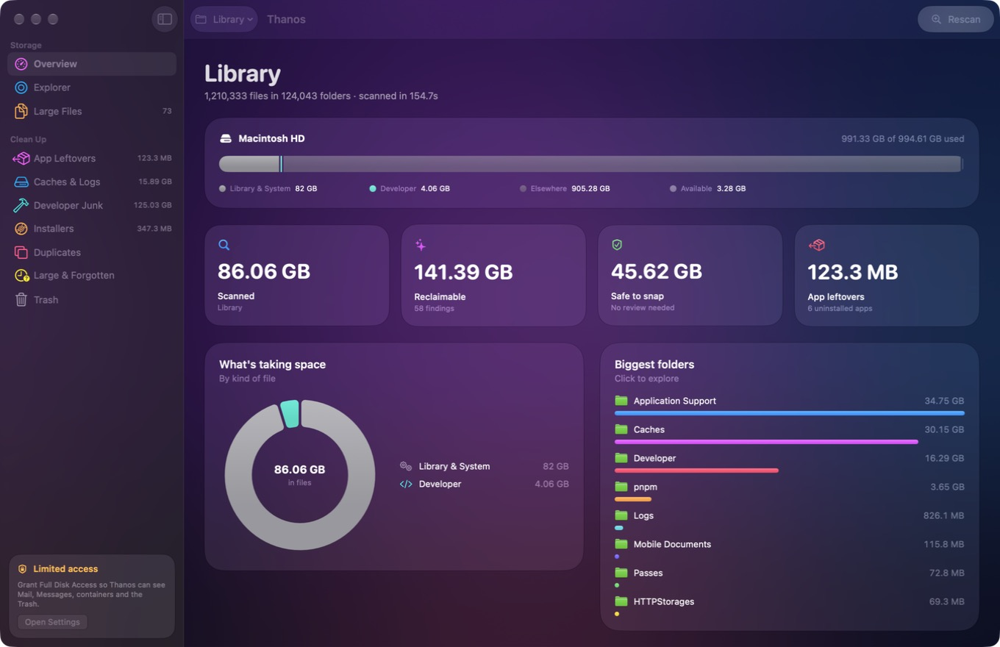
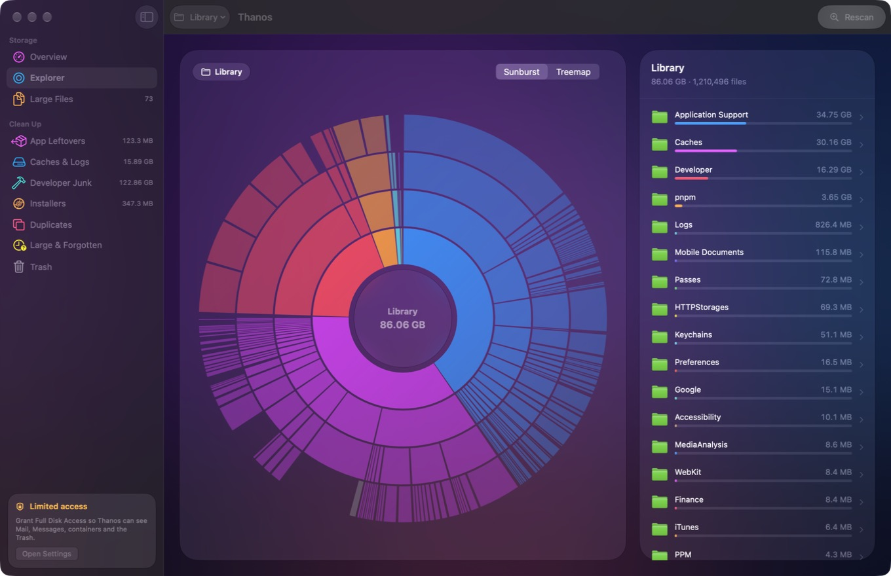
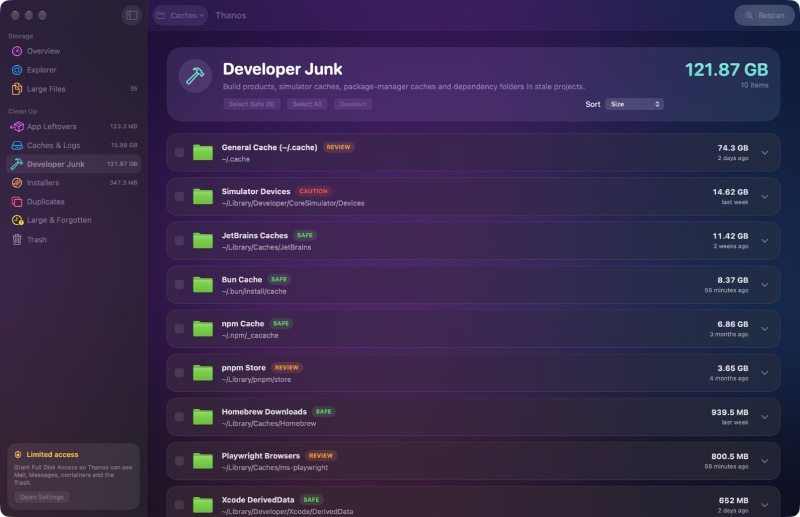

# Thanos

**See everything on your Mac. Keep what matters. Snap the rest away.**

Thanos is a native macOS disk visualizer built with SwiftUI and Liquid Glass. It maps every byte on your disk, finds what uninstalled apps left behind, and moves junk to the Trash — with a reason and a confidence level for every item, so you always know why something is offered.



> **Development preview.** Thanos only ever moves files to the Trash (except when you explicitly empty the Trash), but please review what you remove.

## Features

- **Overview** — a storage bar like System Settings, what kind of files take the space, your biggest folders, and one-click "Snap" for everything marked *Safe*.
- **Explorer** — an interactive sunburst and a squarified treemap. Hover for sizes, click to dive in, click the centre to go back up. Reveal, open or trash anything from the list beside it.
- **Smart clean-up**, each item labelled *Safe*, *Review* or *Caution* with the reason:

| Section | What it finds |
|---|---|
| App Leftovers | Support files, containers, preferences, caches, saved state and launch agents whose bundle identifier no installed app owns — checked against `/Applications`, Spotlight and LaunchServices. |
| Caches & Logs | Per-app caches and user logs that apps rebuild on their own. |
| Developer Junk | Xcode DerivedData and simulators, npm/pnpm/bun/yarn/pip/Homebrew/Gradle/Cargo caches, and `node_modules`, `.venv`, `target`, `.build`, `Pods`, `.next` in projects you haven't touched for a month. |
| Installers | `.dmg`, `.pkg`, `.xip`, `.iso` and `.ipsw` files in Downloads and Desktop. |
| Duplicates | Byte-identical copies outside git repositories, confirmed by SHA-256; hard links excluded, the oldest copy kept. |
| Large & Forgotten | Files over 100 MB untouched for a year. |
| Trash | What's already in the Trash. |

No byte is offered twice: if a folder is already covered by one finding, it is not counted again under another.

| Explorer | Developer Junk |
|---|---|
|  |  |

## Install

Download the latest `Thanos-X.Y.Z.dmg` from [Releases](https://github.com/danielproj/thanos/releases), open it and drag Thanos into Applications. Releases are Developer ID signed and notarized. Requires **macOS 26 or later** on Apple Silicon.

Thanos keeps itself up to date with [Sparkle](https://sparkle-project.org): it checks once a day and offers new versions, and you can also choose **Thanos › Check for Updates…**. Updates are verified with an EdDSA signature before they are installed. Automatic updates start with 0.3.0, so earlier versions need one manual download.

For a complete picture, grant **Full Disk Access** in System Settings › Privacy & Security › Full Disk Access. Without it, Thanos skips other apps' private containers, because reading them would block on a macOS permission prompt.

## Build from source

Requires Xcode 26 or later (macOS 26 SDK).

```bash
scripts/build-app.sh --open    # builds build/Thanos.app
scripts/ci.sh                  # build, tests and checks — the same as CI
```

Development hooks: `THANOS_SCAN=<path>` starts a scan on launch and `THANOS_VIEW=explorer|large|leftovers|caches|developer|installers|duplicates|oldFiles|trash` opens that section.

## Privacy

Thanos collects nothing. Its only network request is the daily update check against this repository's releases, which you can turn off in Settings. See [PRIVACY.md](PRIVACY.md).

## Contributing

Pull requests are welcome — especially new detection rules. See [CONTRIBUTING.md](CONTRIBUTING.md).

## License

[MIT](LICENSE). Third-party software is listed in [THIRD_PARTY_NOTICES.md](THIRD_PARTY_NOTICES.md).
